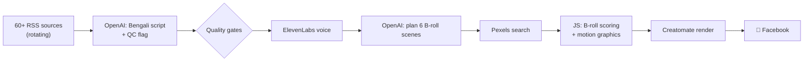

# 02 · SA ASTERION™: Autonomous News-to-Video Engine

**Problem:** Producing a narrated Bengali news video by hand (research, translation, script, voice-over, footage, editing, publishing) takes hours per story.

**Solution:** A fully autonomous Make.com pipeline that turns an English news article into a branded, narrated **1080p Bengali news video** and publishes it to Facebook, with no human in the loop.

## Pipeline (17 modules)


```
Source rotator (60+ RSS sources in Google Sheets)
  ► Read latest article (RSS)
  ► OpenAI: structured Bengali output (headline, 90-sec narration, FB caption, B-roll query, QC flag)
  ► Quality gate: QC = PASS · Bengali script present · no Arabic/Urdu glyphs
  ► ElevenLabs v3: Bengali voice-over          ► Duration gate (≥ ~55 s)
  ► OpenAI: plan 6 story-specific B-roll scenes
  ► Pexels API: search 30 clips per scene
  ► JavaScript: smart B-roll picker + broadcast graphics generator
  ► Google Sheets: B-roll decision log
  ► Creatomate: render B-roll ► render final video (intro + graphics + narration)
  ► Facebook Page: publish with caption, branding and hashtags
```

## Engineering highlights
- **Prompt engineering for broadcast quality:** a detailed newsroom style guide covering legal-safe crime and court wording, person titles, Bengali number spelling, place-name transliteration and a self-correcting QC field.
- **Automated quality gates:** Unicode regex filters block wrong-script output; audio file size is used to enforce minimum narration length.
- **Custom B-roll ranking algorithm (JavaScript):** scores every Pexels clip on keyword hits, an "avoid" list, wrong-country detection, orientation, resolution and duration. It removes duplicates, borrows on-topic clips for weak scenes and validates a gap-free timeline before rendering.
- **Programmatic motion graphics:** generates Creatomate JSON for animated BREAKING/NEWS tickers, a scrolling map band, an animated logo and smart two-line Bengali headline wrapping.
- **Observability:** every B-roll decision and score is logged to a sheet for review.

## Stack
Make.com · RSS · OpenAI (structured outputs) · ElevenLabs · Pexels API · JavaScript (Code module) · Creatomate · Google Drive · Google Sheets · Facebook Pages

**Result:** in production for SA Media News with **200+ automated runs**.
