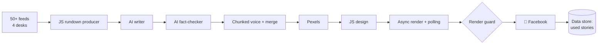

# 03 · SA PRIME BULLETIN: Multi-Desk AI Newsroom

**Problem:** A single-story video is not a real news bulletin. The goal was a TV-style multi-segment bulletin (Local · War · Immigration · Sport) produced automatically several times a day.

**Solution:** An orchestrated Make.com system that pulls from **50+ news feeds**, plans a rundown like a TV producer, writes and fact-checks each segment with AI, voices it, picks footage, renders a premium video and publishes it every 8 hours.

## Architecture


```
Data store: state + already-used stories
  ► 50+ HTTP feed requests across 4 desks (Local · War · Immigration · Sport)
  ► JS "Rundown Producer": picks the best fresh stories → 4 segments, no repeats
  ► Per segment:  AI Segment Writer (Bengali) ► AI Segment Fact-Checker
  ► JS: assemble bulletin script + voice plan (chunked)
  ► ElevenLabs v3 per chunk with timestamps ► JS: merge voice track
  ► Google Drive: host narration
  ► Pexels search per visual query ► JS: premium design / timeline builder
  ► Creatomate async render: start → 7 × (wait + status check) polling loop
  ► Render guard: fail loudly on bad output
  ► Facebook publish ► Data store: save used stories + debug records
```

## Engineering highlights
- **Two-stage AI (writer → fact-checker):** a second model pass reviews each segment against its source before it is voiced.
- **Producer logic in code:** ranking, de-duplication and segment allocation run in JavaScript, not in the prompt, so they are deterministic and testable.
- **Chunked voice with timestamps:** long scripts are split for ElevenLabs and merged back together, which keeps quality high and avoids length limits.
- **Async render polling:** a non-blocking start-then-poll pattern for long Creatomate renders, with a guard step that stops publishing if the render fails.
- **Stateful memory:** Make data stores remember published stories so no bulletin repeats a story.

## Stack
Make.com · HTTP · Data Stores · JavaScript · OpenAI · ElevenLabs · Pexels · Creatomate API · Google Drive · Facebook Pages

**Result:** runs automatically **every 8 hours** for SA Media News.
