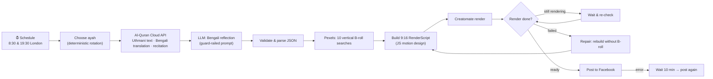

# 05 · মদিনা মুনাওয়ারা: Automated Quran-Ayah Video Channel (n8n)

**Problem:** Religious content must be **accurate**. AI is good at writing but can invent quotes, references or rulings, which is unacceptable for Quran content. The channel also needed sharp, beautiful vertical videos twice a day without an editor.

**Solution:** A self-hosted **n8n** workflow that builds every episode from **verified sources only**. AI is used just to write a short reflection, under strict guard-rails. It renders a 9:16 video and posts it to Facebook at 9:00 and 19:00 London time.

## Architecture

## Engineering highlights
- **Verified content first:** the Arabic text, the Bengali translation (Maulana Muhiuddin Khan) and the recitation (Sheikh Mishary Alafasy) come from Al-Quran Cloud. The AI never generates them.
- **Guard-railed AI:** the prompt forbids citing other verses, hadith, rulings or invented facts. It also keeps track of *who is addressed* in the ayah and returns strict JSON, which is validated before use.
- **Deterministic scheduling:** the ayah is chosen with a date and slot formula, so morning and evening episodes never collide and no database is needed.
- **Bengali text-to-speech engine:** numbers are converted to Bengali words (up to কোটি) and symbols are removed before narration, so the voice-over always sounds natural.
- **Programmatic motion design:** intro, recitation, meaning, three reflection scenes and an outro are generated as Creatomate JSON, with Arabic (Amiri) and Bengali (Hind Siliguri) typography, gold accents, light sweeps and Ken Burns zoom.
- **Self-healing:**
  - A failed render is retried automatically without B-roll.
  - A failed Facebook post is retried after 10 minutes.
  - A second failure stops the run with a clear error instead of posting something broken.

## Stack
n8n (self-hosted, Docker) · Al-Quran Cloud API · OpenAI (LLM chain) · Pexels API · Creatomate API · ElevenLabs (via Creatomate) · Facebook Graph API

**Result:** runs automatically twice a day in production.
