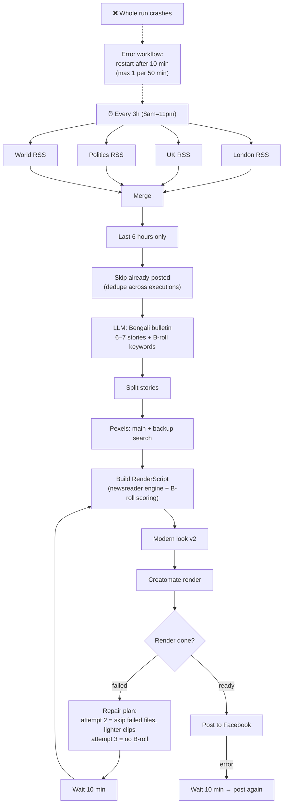

# 06 · GREENWICH: Self-Healing Bengali News Bulletin (n8n)

**Problem:** A news channel that posts every 3 hours cannot depend on someone watching it. RSS feeds go down, stock clips fail to load and video renders sometimes fail, and each failure means a missed bulletin.

**Solution:** A production **n8n** newsroom that turns 4 live news feeds into a branded, voiced Bengali video bulletin every 3 hours (8am–11pm). It has **three layers of self-repair**, so it recovers from failures without a human.

## Architecture

## Engineering highlights
- **Three layers of self-repair:**
  - **Render level:** reads the Creatomate error, blacklists the failing file URLs, then retries with lighter clips. If that fails too, it retries with no B-roll. It stops after 3 attempts.
  - **Publish level:** a Facebook failure is retried after 10 minutes.
  - **Workflow level:** a separate **error workflow** restarts the whole run 10 minutes after a crash. A rate limit stored in workflow static data (max one restart per 50 minutes) prevents endless loops.
- **Never repeats a story:** stories are deduplicated by link across executions, and only items from the last 6 hours are used.
- **Bengali newsreader engine (JavaScript):**
  - Speaks numbers, money, percentages, times, years, ordinals and ranges as natural Bengali words.
  - Normalises names and party names, and spells out acronyms letter by letter.
  - Adds the correct title on a person's first mention.
  - Generates varied source lead-ins, such as *"বিবিসি জানিয়েছে" → "বিবিসি আরও জানিয়েছে"*.
- **B-roll scoring:** every Pexels candidate is scored on keyword match, aspect ratio, duration and resolution, with a backup search per story and no duplicate clips.
- **Fail-safe styling:** the "Modern Look v2" layer restyles only the first attempt. Repair attempts fall back to the proven classic layout.
- **Original audio:** background music comes from a companion n8n workflow that serves an original, royalty-free loop, so there are no copyright claims.

## Stack
n8n (self-hosted) · RSS · OpenAI (LLM chain) · Pexels API · Creatomate API · ElevenLabs · Facebook Graph API · n8n Error Workflow · Workflow Static Data

**Result:** posts automatically every 3 hours and recovers from failures without manual work.
